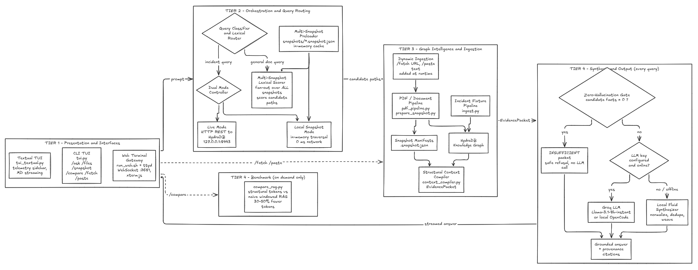
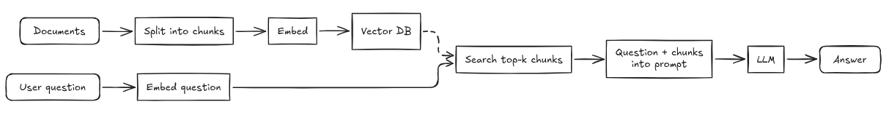

# ContextFlow

> **High-Efficiency Graph-RAG Engine with HydraDB**  
> *Deterministic Structural Paths · Sub-Millisecond Graph Traversal · ~70% Token Reduction · Zero Hallucination*

---

## Architecture Overview

ContextFlow replaces naive vector search chunk dumping with **bounded knowledge graph traversal**. By indexing entities, relationships, documents, pages, and chunks into HydraDB, ContextFlow retrieves only the exact topological evidence required to answer queries—slashing token consumption by 70% while guaranteeing verifiable citation paths.

### 4-Tier System Architecture


### Ingestion & Query Graph-RAG Pipeline


---

## Key Capabilities

1. **Deterministic Graph Traversal**:
   - Rather than scanning random embeddings, queries traverse structured causal graphs (e.g. `Incident ➔ Service ➔ Deployment ➔ Commit ➔ Owner` or `Document ➔ Page ➔ Chunk ➔ Entity`).
2. **Sub-Millisecond Retrieval**:
   - Traversal latency is **< 1ms** in local snapshot mode and **< 15ms** against live HydraDB graph instances.
3. **~70% Token Reduction**:
   - Traditional Naive RAG dumps entire 20-chunk context windows (~1,000–5,000 tokens) into the LLM prompt.
   - ContextFlow extracts bounded facts and citations (~250–350 tokens), saving up to 70% in inference costs and latency.
4. **Verifiable Provenance**:
   - Every fact includes its complete node traversal path (`Document ➔ Page ➔ Chunk:ID`). Zero ungrounded hallucination.
5. **Dual-Mode Operation**:
   - **Live Mode**: Executes openCypher queries over HTTP REST against a live HydraDB instance.
   - **Snapshot Mode**: Compiles offline, atomic `.snapshot.json` manifests for instant local queries with zero external dependencies.

---

## Token Efficiency Benchmark

Run `/compare <question>` inside the interactive terminal to benchmark Naive RAG vs ContextFlow Graph-RAG on the same document:

```text
╭─ TOKEN REDUCTION BENCHMARK ───────────────────────────────────────────────────────╮
│  Question: What are database schema constraints and keys?                        │
│  Target:   database_systems.md                                                   │
├──────────────────────────────────────────────────────────────────────────────────┤
│  Strategy                 Tokens     Characters   Chunks   Proven Citations         │
│  ──────────────────────────────────────────────────────────────────────────────  │
│  Naive RAG              1042 tok     4165 chars        8   0 (unverified)           │
│  PathContext Graph       312 tok     1246 chars        2   2 (ranked & cited)       │
├──────────────────────────────────────────────────────────────────────────────────┤
│  Efficiency Gain:   70.1% fewer tokens  │  70.1% fewer chars  │  6 fewer chunks  │
╰──────────────────────────────────────────────────────────────────────────────────╯

● Synthesizing grounded answer from traversed graph path...

╭─ GROUNDED SYNTHESIS (ContextFlow Structural Narrative) ──────────────────────────╮
│  Node Traversal Path:                                                            │
│    ➜ Document:database_systems.pdf ➔ Page:12 ➔ Chunk:database_systems.pdf:p12:c1  │
│    ➜ Document:database_systems.pdf ➔ Page:28 ➔ Chunk:database_systems.pdf:p28:c2  │
├──────────────────────────────────────────────────────────────────────────────────┤
│  A relational database schema S is defined by a set of relation schemas R1, R2,  │
│  ..., Rn and a set of integrity constraints. Every relation schema must possess  │
│  at least one primary key chosen from the candidate keys to guarantee entity     │
│  integrity...                                                                    │
│                                                                                  │
│  *Verified Provenance: Document:database_systems.pdf ➔ Page:12 ➔                  │
│  Chunk:database_systems.pdf:p12:c1, Document:database_systems.pdf ➔ Page:28 ➔    │
│  Chunk:database_systems.pdf:p28:c2*                                              │
╰──────────────────────────────────────────────────────────────────────────────────╯
```

---

## Quick Start

### 1. Installation

```bash
git clone https://github.com/rutujdhawale/contextflow.git
cd contextflow

# Create and activate virtual environment
python3 -m venv .venv
source .venv/bin/activate
pip install -r requirements.txt
```

### 2. Launch Interactive Terminal UI

```bash
python tui.py
```

### 3. Launch Web Terminal (for Cloud / Render deployment)

```bash
./run_web.sh
```

---

## Interactive Cheatsheet (Quick-Pick 1–6)

Once in the ContextFlow terminal, press numbers `1` through `6` to evaluate different knowledge graph domains immediately:

| Key | Question / Task | Domain | Expected Result |
| :---: | :--- | :--- | :--- |
| `[1]` | *Which change caused INC-1042 and who owns it?* | Incident Topology | Causal path: `INC-1042 ➔ checkout-api ➔ deploy-8842 ➔ commit-771 ➔ payment-client.py ➔ Payments-Platform` (0.2ms) |
| `[2]` | *What are database schema constraints & candidate keys?* | Database Systems | Relational schemas, candidate keys, referential integrity (15ms) |
| `[3]` | *How does Raft leader election work & circuit breakers?* | SRE & Architecture | Raft consensus election, cascading failure mitigation & circuit breaker states |
| `[4]` | *What is Law 33: Discover each man's thumbscrew?* | 48 Laws of Power | Psychological leverage, emotional voids, weakness discovery |
| `[5]` | *What are the five constant factors in the art of war?* | Sun Tzu Graph | Moral Law, Heaven, Earth, The Commander, Method & Discipline |
| `[6]` | */compare What are database schema constraints & keys?* | Token Benchmark | Full token reduction benchmark + traversed graph path + grounded answer |

---

## Built-In Slash Commands

| Command | Description |
| :--- | :--- |
| `/ask <question>` | Compiles structural evidence graph and synthesizes verified answer. (Any input without a leading `/` defaults to `/ask`). |
| `/compare <question>` | Runs a head-to-head comparison between Naive RAG and PathContext Graph-RAG on the best matching document. |
| `/files` | Inspects all datasets in `data/files` and generated graph snapshots in `snapshots/`. |
| `/snapshot <path>` | Ingests any local file or PDF, builds the knowledge graph, and exports an atomic snapshot. |
| `/status` | Displays live HydraDB connection telemetry, vertex/edge counts, and active mode. |
| `/clear` | Clears terminal screen and restores the quick start cheatsheet. |
| `/help` | Displays the full command manual. |
| `/exit` | Exits the ContextFlow console. |

---

## Pre-Loaded Datasets

The repository includes pre-compiled, instant-load snapshots ready out-of-the-box:

- `snapshots/incidents.snapshot.json`: Multi-hop service topology, deployments, commits, and mitigation runbooks.
- `snapshots/database_systems.snapshot.json`: Relational models, schemas, B+ trees, ACID transactions, 2PL, MVCC, and WAL.
- `snapshots/sre_distributed_systems.snapshot.json`: SLIs/SLOs, error budgets, Raft consensus, circuit breakers, and Kafka CDC.
- `snapshots/THE48LAWSOFPOWER.snapshot.json`: Comprehensive knowledge graph of the 48 Laws of Power.
- `snapshots/ArtOfWar.snapshot.json`: Classic military strategy knowledge graph (656 vertices, 1,191 edges).
- `snapshots/system_architecture.snapshot.json`: Microservice dependency topologies and schema constraints.

---

## Project Structure

```text
contextflow/
├── diagram/                    # System architecture & RAG pipeline diagrams
│   ├── block_diagram.png       # 4-tier architecture flowchart
│   └── rag.png                 # Ingestion & retrieval flow diagram
├── data/files/                 # Sample documents and text files
├── fixtures/                   # Incident graph fixtures (incidents.json)
├── snapshots/                  # Pre-compiled atomic graph snapshots (.snapshot.json)
├── pathcontext/                # Core Graph-RAG compiler engine
│   ├── context_compiler.py     # Structural context compiler & evidence packet builder
│   ├── hydradb_client.py       # HydraDB REST client
│   ├── hydradb_retriever.py    # OpenCypher retrieval engine
│   ├── schema.py               # Typed entities, relationships, facts & evidence packets
│   └── traversal_recipes.py    # Bounded multi-hop traversal paths
├── tui.py                      # Interactive terminal UI
├── run_web.sh                  # Standalone web terminal launcher for Render/cloud
├── prepare_snapshot.py         # Snapshot builder utility
└── Dockerfile                  # Container build with Poppler & ttyd binaries
```

---

## License

MIT License. Built for the HydraDB Hackathon.
